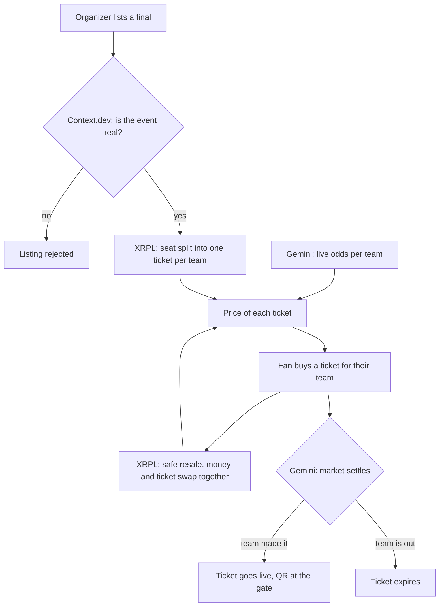

# Fairseat

**We sell one seat to several fans, and the playoffs decide who sits in it.**

The original write-up of the idea is kept in
[FAIRSEAT-original.md](FAIRSEAT-original.md).

## Explain it to the team

> When tickets for a final go on sale, nobody knows which teams will play.
> So a fan pays full price and hopes. If their team is knocked out, they are
> stuck with a ticket to a game they don't care about.
>
> Fairseat sells the same seat once per team. A Chiefs fan buys "this seat, if
> the Chiefs make it". A Bills fan buys the same seat "if the Bills make it".
> Each pays only a fraction of the full price, based on their team's live odds.
>
> As the playoffs go on, the odds change and so does the value of each ticket.
> Fans can resell safely at any time. When the finalists are known, the winning
> fan's ticket becomes the real one and the others expire.
>
> Fans pay less and only for a game their team is in. The organizer still
> collects the full price of the seat. The arena fills with real fans.

## The problem

- Finals tickets go on sale before the finalists are known.
- Fans of eliminated teams dump tickets, and scalpers buy them up.
- Buying a resold ticket from a stranger is risky: one side has to pay or send
  first.
- Fake events and fake ticket sites are everywhere around big tournaments.

## How it works

1. **Organizer lists the event.** Fairseat checks the official venue site, the
   dates, and the company behind it before anything goes on sale.
2. **Each seat is split per team.** One conditional ticket per team still in
   the running.
3. **Live odds set the prices.** A team with a 45% chance of reaching the final
   costs about 45% of the seat's full price.
4. **Fans buy and resell.** Payment and ticket swap at the same moment, so
   neither side can cheat. The organizer earns a cut of each resale.
5. **The market settles the seat.** When the finalists are decided, the winning
   ticket becomes a real entry pass with a live QR code. The others expire.

## Pipeline

## Example

A $1,000 Super Bowl seat on the AFC side, sold while four teams are alive:

| Ticket | Odds of reaching the final | Price |
|---|---|---|
| "If the Chiefs make it" | 45% | $450 |
| "If the Bills make it" | 30% | $300 |
| "If the Ravens make it" | 15% | $150 |
| "If the Texans make it" | 10% | $100 |

The numbers above are illustrative. The four prices add up to the full seat
price, so the organizer is paid in full either way.

## Sponsors and tracks

| Sponsor | Job in the product |
|---|---|
| Ripple (XRPL) | Issues the tickets, holds the money, swaps ticket and payment together, pays the organizer's resale cut |
| Gemini Prediction API | Live odds set every price, and the market result decides which ticket becomes real |
| Context.dev | Checks that an event and its organizer are real before listing |

- General track: **Most Creative**
- Sponsor tracks: **Ripple**, **Gemini**, plus the **Context.dev** bonus
- ElevenLabs is parked, not dropped. It has no job in the product yet. If voice
  earns a place later (a phone line that checks a ticket, or buying by voice),
  the bonus track is still open.

## Design decisions

- **Type:** Lime's own fonts. Hanken Grotesk for text, the system monospace for
  prices, odds, tickers and seat codes.
- **Design system:** Lime from design.how, installed through shadcn, with its
  accent retuned from acid lime to blue (`#356ed8`, the creator-ops brand
  blue). Installing a Lime component resets the theme, so run
  `python3 scripts/retune-lime.py` afterwards.
- **Components:** Lime components only, in `components/lime`. Check with
  `npx eslint -c lime.eslint.config.mjs .`
- **Layouts:** every screen is structured from a Mobbin reference. No guessed
  layouts.

## How prices work (live since phase 3)

- Odds, team art, event photos and results come from Gemini's public market
  data. Nothing about a team is hard-coded.
- A team's raw chance is the middle of the market's best bid and best ask. If
  there is no bid, the last trade is used.
- Each team's **share of the seat** is its chance divided by the sum of all the
  chances. The shares add up to 100%, so the tickets for a seat always add up
  to its full price and the organizer is paid in full.
- A ticket costs the seat's full price times the team's share.
- When Gemini settles a team's contract as a no, that team is out and its
  tickets expire. When a contract settles as a yes, that ticket becomes the
  seat.
- The seat page refreshes its prices from Gemini every 15 seconds.

## Team colors

Lime has one accent. Comparing teams needs more, so `app/teams.css` adds eight
color pairs (a strong step and a soft step each, the same idea as the paired
colors in creator-ops), plus a neutral pair. A team gets its color from its
rank in the market. They are used only in the ownership bar and the odds
chart.

## Gemini markets that fit (checked live 2026-10-11)

Gemini's public market list has "which team reaches the final" markets for
many sports. No account is needed to read them.

| Market | Ticker | Outcomes | Fits |
|---|---|---|---|
| AFC Championship Winner | `AFCCHAMP27` | 16 | Super Bowl, AFC side of the stadium |
| NFC Championship Winner | `NFCCHAMP27` | 16 | Super Bowl, NFC side |
| American League Champion | `ALCHAMP26` | 15 | World Series |
| National League Champion | `NLCHAMP26` | 15 | World Series |
| MLS Eastern / Western Conference Champion | `MLSEAST26`, `MLSWEST26` | 15 each | MLS Cup |
| College Football Playoff Qualifiers | `CFBPLAYOFF2627` | 50 | College playoff games |
| Champions League Winner | `UCL2627` | 29 | Champions League final |

Live prices at the time of checking (baseball playoffs are in progress, so
these move today):

| Market | Team | Bid | Ask |
|---|---|---|---|
| National League Champion | Los Angeles D | 0.57 | 0.63 |
| National League Champion | Milwaukee | 0.37 | 0.42 |
| American League Champion | Tampa Bay | 0.59 | 0.65 |
| American League Champion | Cleveland | 0.34 | 0.41 |

Endpoint used:
`https://api.gemini.com/v1/prediction-markets/events?status=active&category=Sports`

## How the XRP Ledger is used (live since phase 4)

Everything runs on the XRPL testnet. Code: `lib/fairseat/xrpl.ts`. The README has the full table.

- **Two accounts.** The issuer issues the test dollar. The organizer mints the tickets and is who
  the money ends up with.
- **The ticket is an NFT** naming the event, the seat and the team, with a 5% transfer fee the
  ledger pays the organizer on every resale.
- **Buying is one Batch.** The fan's payment goes into a token escrow for the organizer and the
  ticket moves to the fan, or neither happens.
- **The money waits in escrow** until the finalists are decided. Only Fairseat can release it. If it
  never is, the fan can take it back a month after the event.
- **Reselling is one swap between fans.** The holder lists the ticket at their own price. It shows
  on the seat page as "Resale". A gift is the same offer at a price of 0, taken at `/claim/<offer>`.
- **Settlement is one Batch.** It releases every payment for that side and burns the tickets for
  teams that missed out. A Batch can be recorded as a success when its parts were turned away, so
  every escrow and ticket is read back from the ledger before anything is marked as settled. Until
  a real market settles, `/demo` stages a result first.

RLUSD was the plan for the currency. Its testnet issuer has not enabled escrow for its token, so an
escrow in RLUSD is refused. Smart escrow and the lending features are not on testnet yet.

Fairness rules, checked by the server (`lib/fairseat/rules.ts`): one wallet holds at most 4 tickets
for the same team in an event, and a resale asks at most 150% of what the ticket costs new right
now. A fan takes an unreleased payment back from the ticket page or the wallet page once the
deadline has passed. The ticket is burned in return and the seat goes back on sale. `/demo` can
shorten that deadline to 2 minutes for new purchases.

Not built: a second condition for finals played at home arenas.

## How Context.dev is used (live since phase 4)

An organizer cannot put an event on sale until it passes three checks. Code:
`lib/fairseat/context.ts`.

1. **The official page.** Context.dev opens the page the organizer linked and returns the name, date
   and venue it finds. All three must match what the organizer typed.
2. **A second opinion.** Context.dev researches the event on the open web, without the organizer's
   page. If it finds a different date or venue, the event is blocked. A fake page cannot fool this.
3. **The site's owner.** Context.dev says who runs the site the page is on. This is shown, not
   enforced.

Each check shows a pass or a fail with what was found. The plan allows one request at a time, so the
three run one after another and take about 15 seconds.

## The demo (2 minutes)

1. Several phones on screen, each holding the same seat for a different team at
   a different price.
2. A playoff game is live. One team scores.
3. That team's ticket price jumps on screen in real time. The others drop.
4. The series ends. The losing tickets fade out. One turns into a gate QR code.

Use the baseball markets for the live demo, since those games are being played
now. Use the Super Bowl as the story in the pitch.

## Open questions

- **Neutral venues only.** Splitting a seat per team works when the venue is
  fixed in advance (Super Bowl, Champions League final). A World Series game is
  played at the winning team's own stadium, so the seat itself changes.
- **Thin markets.** Some teams have no bid at all. Prices for long shots need a
  fallback.
- **Losing tickets.** Decide whether a losing ticket simply expires or returns
  a small consolation.
- **Side payments.** Buyers and sellers can still agree extra money outside the
  app.
